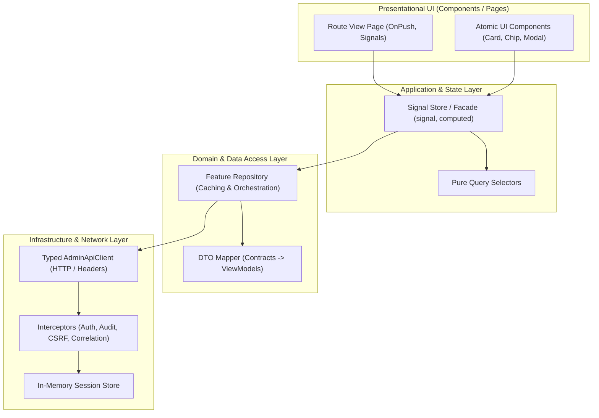

# NukkadNow Super-Admin Console — Master Sprint Roadmap

> **Document ID:** NNK-ADM-ROADMAP-001  
> **Version:** 1.0 · Engineering Execution Baseline  
> **Product:** NukkadNow Super-Admin & Platform Operations Portal  
> **Target Scope:** Nagpur Locality Pilot & Multi-Tenant Hyperlocal Scale  
> **Architectural Paradigm:** Angular 18+ Standalone, TypeScript 5.5 (Strict Mode), DDD Clean Architecture, Signals Reactivity, Zero-Trust Security  
> **Cadence:** 2-Week Sprints (Sprint 00 is 1-Week Architectural Foundation)  

---

## 1. Executive Summary & Purpose

The **NukkadNow Super-Admin Console** is the restricted, high-assurance operational backbone for governing the NukkadNow hyperlocal marketplace and merchant SaaS ecosystem. It provides platform operators, compliance officers, finance administrators, and support agents with real-time operational oversight across 23 core domain capabilities—from merchant verification and catalog moderation to live order intervention, escrow settlements, dual-approval refunds, and immutable audit logs.

This Master Roadmap lays out a disciplined, sequential **16-Sprint Execution Plan (Sprint 00 through Sprint 15)** designed by senior enterprise architects to guarantee:
- **DRY (Don't Repeat Yourself):** Zero logic or presentation duplication. Reusable data grids, search bars, modal wrappers, and formatters are centralized in `@nukkadnow/admin-*` shared packages.
- **KISS (Keep It Simple, Stupid):** High-density, clutter-free tabular workspaces with intuitive 1-click or 2-click operator workflows. Zero cognitive overload.
- **SOLID Principles:** Strict Clean Architecture separation (Presentational Components $\rightarrow$ Feature Stores/Facades $\rightarrow$ Data Access Repositories $\rightarrow$ Typed API Client).
- **Fortified Zero-Trust Security:** Mandatory MFA, step-up authentication for high-risk actions, cryptographic audit headers, in-memory token lifecycle, automated inactivity locks, PII masking, and hardened CSP.
- **High Scalability & Performance:** Fine-grained Angular Signals reactivity, `OnPush` change detection, virtualized data tables handling 10,000+ items smoothly, and memory-safe WebSocket reconnect streams.

---

## 2. Master Sprint Schedule & Delivery Matrix

| Sprint ID | Sprint Name | Core Focus & Domains | Key Deliverables & Milestones |
|---|---|---|---|
| **Sprint 00** | Architecture Foundation & Tooling | Workspace, Monorepo Boundaries, Tooling | pnpm workspace, Turborepo caching, boundary checker, strict tsconfig, base configs |
| **Sprint 01** | Design System & High-Performance Data Table | Admin UI Kit, Tables, Theming, Primitives | Dark theme design tokens, atomic UI primitives, virtual scroll data table, pagination |
| **Sprint 02** | Operator Auth, MFA & Session Security | Login, MFA Challenge, Step-Up, Screen Lock | Zero-trust in-memory auth, TOTP verification, 15-min idle lock, step-up challenge engine |
| **Sprint 03** | Command Center & Real-Time Telemetry | Executive KPI Dashboard, Heatmaps, Search | Real-time GMV counters, Nagpur locality pressure map, live alerts, `Ctrl+K` palette |
| **Sprint 04** | Merchant Directory & Lifecycle Management | Merchant Registry, Profiles, Suspension | Merchant master directory, business mode badges, suspension modal with mandatory reason |
| **Sprint 05** | Merchant Verification & Regulatory KYC | FSSAI, GSTIN, PAN, Penny-Drop Bank Reconciliation | KYC review queue, document zoom/audit, automated bank match status, approval workflow |
| **Sprint 06** | Outlets, Nagpur Localities & Geofences | Outlets Directory, Hours, Geofence Polygons | Outlet schedule overrides, capacity throttles, Nagpur micro-market boundary management |
| **Sprint 07** | Category Taxonomy & Commission Slabs | Categories Tree, Commission Slabs, Surcharges | Category CRUD, percentage commission rules, restricted items toggles, age-gates |
| **Sprint 08** | Catalog Moderation & Takedown Engine | Product Queue, Price Sanity, Flagged Media | Fat-finger price alerts, prohibited items scanner, 1-click takedown with audit justification |
| **Sprint 09** | Live Orders Stream & Emergency Intervention | Real-Time Orders, SLA Tracker, Cancellations | Live order timeline, kitchen delay badges, emergency cancellation override with refund hook |
| **Sprint 10** | Payments, Settlements & Webhook Replay | Gateway Ledger, Escrow Payouts, Webhooks | Transaction audit table, payout batch release, failed PSP webhook inspection and replay |
| **Sprint 11** | Refunds & Four-Eyes Dual Approval | Refund Queue, Dual-Sign Approval, Disputes | Staged refund workflow, dual-operator authorization (> ₹5,000), dispute evidence ledger |
| **Sprint 12** | Merchant SaaS Subscriptions & Billing | Subscription Tiers, Billing Cycles, Invoices | SaaS plan manager, recurring billing tracker, exemption waivers, GST invoice viewer |
| **Sprint 13** | Support Helpdesk & Reviews Moderation | Support Tickets, Agent Queue, Review Spam | Unified support inbox, SLA timer alerts, customer ticket triage, review moderation queue |
| **Sprint 14** | Platform Governance, RBAC & Feature Flags | Operators Directory, Role Matrix, Kill-Switches | Staff accounts, 48 granular permissions matrix, runtime feature flags with step-up MFA |
| **Sprint 15** | Immutable Audit Trail, PII Unmasking & Launch | Cryptographic Logs, PII Audits, E2E Tests | Append-only audit viewer, click-to-unmask audited PII, Playwright test suite, production build |

---

## 3. Architectural Tenets & Coding Standards

### 3.1 DRY (Don't Repeat Yourself)
1. **Centralized Enterprise Primitives:** All data tables, search filters, pagination bars, metric tiles, status chips, and modal dialogs originate from `@nukkadnow/admin-ui` and `@nukkadnow/admin-data-table`.
2. **Zero Inverted Dependencies:** Shared libraries in `libs/` never import from feature pages or layout components.
3. **Unified API Gateway Contracts:** All HTTP paths and payloads map to `@nukkadnow/admin-api-client` endpoints; no feature hand-codes raw URL strings.

### 3.2 KISS (Keep It Simple, Stupid)
1. **High-Density Single-Screen Focus:** Operations teams handle high volumes; layouts prioritize dense tabular views over multi-step wizards where a direct table action suffices.
2. **2-Click Operator Workflows:** High-frequency actions (e.g., verifying an FSSAI certificate or accepting an order dispute) require at most 2 clicks with integrated modal confirmation.
3. **Predictable Signal Reactivity:** Feature state relies on native Angular Signals (`signal()`, `computed()`) without redundant boilerplate libraries.

### 3.3 SOLID Principles Implementation
- **Single Responsibility Principle (SRP):** UI components render and capture intent; Stores maintain reactive state; Repositories orchestrate network and caching; Interceptors handle security headers.
- **Open/Closed Principle (OCP):** Policy and permission evaluation engine (`PolicyEngine`) allows adding new roles or permission rules without altering existing guard or interceptor code.
- **Liskov Substitution Principle (LSP):** All API services implement consistent observable interfaces with normalized `ApiResponse<T>` and `PaginatedResult<T>` envelopes.
- **Interface Segregation Principle (ISP):** Component templates consume tailored `ViewModel` interfaces (e.g., `MerchantSummaryViewModel`) instead of sprawling backend relational entities.
- **Dependency Inversion Principle (DIP):** Features depend on abstract injection tokens and repository ports rather than hardcoded HTTP client implementations.

---

## 4. Zero-Trust Security Architecture Summary

1. **In-Memory Token Security:** Raw JWT bearer tokens are stored strictly in memory (`AdminSessionService`). Never persisted in `localStorage` or `sessionStorage`.
2. **Mandatory Step-Up Authentication:** Irreversible or high-financial-impact operations require secondary TOTP verification, issuing a short-lived `X-Step-Up-Ticket` (300-second TTL).
3. **Mandatory Cryptographic Audit Headers:** Mutating HTTP verbs (`POST`, `PUT`, `PATCH`, `DELETE`) inject `X-Admin-Operator-Id`, `X-Audit-Reason`, `X-Audit-Justification`, and `X-Correlation-Id`.
4. **Automated Inactivity Screen Lock:** Detects user inactivity across tabs after 15 minutes, auto-locking the console with an animated countdown warning.
5. **PII Masking by Default:** Sensitive personal data (Indian phone numbers, PAN, GSTIN, Aadhaar, residential addresses) is masked. Unmasking triggers an audited security event.
6. **Hardened Ingress & CSP:** Nginx container enforces strict `Content-Security-Policy`, `X-Frame-Options: DENY`, `HSTS`, `Permissions-Policy`, and non-root execution.
7. **Crawler Shield:** `robots.txt` strictly disallows all search engine crawlers from indexing administrative URLs.

---

## 5. Definition of Done (DoD) for Every Sprint

Every sprint must fulfill this standard quality checklist before being merged:
- [ ] Comprehensive sprint specification document authored and approved in `docs/sprints/`.
- [ ] All components enforce `ChangeDetectionStrategy.OnPush` and Angular Signals reactivity.
- [ ] Strict TypeScript compilation passing with zero `any` types (excluding untyped 3rd-party libs).
- [ ] ESLint architectural boundary validation (`node tools/check-boundaries.mjs`) passing with 0 violations.
- [ ] Production security headers check (`node tools/verify-security-headers.mjs`) passing.
- [ ] Unit tests with Karma/Jasmine covering stores, repositories, and critical security guards.
- [ ] Playwright E2E smoke tests validating user workflows and permission boundaries.
- [ ] Loading, error, empty, and unauthorized states handled cleanly in templates.
- [ ] Zero secrets, private keys, or backend connection strings committed in code.
