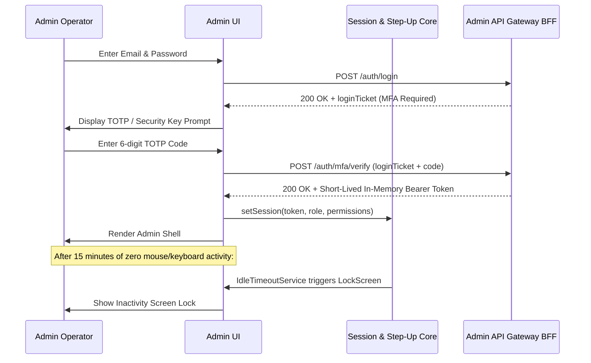

# Sprint 02 — Operator Authentication, MFA, Step-Up Privilege & Inactivity Lock

- **Sprint ID:** NNK-ADM-SPRINT-02
- **Duration:** 2 Weeks
- **Target Scope:** `src/app/core/auth/*`, `src/app/core/http/*`, `src/app/features/authentication/*`
- **Dependencies:** Sprint 00, Sprint 01

---

## 1. Principles & Coding Standards

### DRY & KISS
- **Centralized Session State:** `AdminSessionService` is the single source of truth for the operator's active session, role, and permission grants. No duplicate checks across components.
- **KISS Auth Flow:** Simple linear flow: `Login (Credentials) → MFA Challenge (6-digit TOTP) → Console Entry`. If inactive for 15 minutes, transition directly to `Lock Screen` without terminating background tasks.
- **Declarative Interceptors:** `adminAuthInterceptor` automatically injects `Authorization: Bearer <token>` without feature code needing to manually pass headers.

### SOLID Standards
- **Single Responsibility (SRP):**
  - `AdminSessionService`: Manages in-memory token lifecycle and operator profile.
  - `MfaChallengeService`: Handles TOTP and WebAuthn challenge verification requests.
  - `StepUpAuthService`: Coordinates elevated privilege challenges and short-lived tickets.
  - `IdleTimeoutService`: Tracks physical keyboard/mouse activity and triggers lock timer.
- **Open/Closed (OCP):**
  - Challenge verification supports multiple MFA factors (`TOTP`, `WEBAUTHN`, `HARDWARE_KEY`) without changing caller logic.
- **Dependency Inversion (DIP):**
  - Route guards and interceptors depend on `AdminSessionService` interface rather than directly reading browser storage.

---

## 2. Security Architecture & Threat Defense



1. **Zero Persistent Token Storage (Anti-XSS):**
   - Access tokens are stored **in-memory only** within Angular Signals.
   - If an XSS vulnerability occurs elsewhere, attacker cannot harvest tokens from `localStorage` or `sessionStorage`.
2. **Elevated Step-Up Authentication:**
   - Actions carrying financial or regulatory risk require re-verification.
   - Successful challenge yields an ephemeral `X-Step-Up-Ticket` (300-second TTL).
3. **Automated Console Inactivity Lockout:**
   - Workstations left unattended auto-lock after 15 minutes.
   - Animated 60-second warning banner gives active operators an opportunity to extend their session.
4. **Anti-CSRF & Correlation Interceptors:**
   - `csrf.interceptor.ts` injects `X-XSRF-TOKEN` into state-modifying requests.
   - `correlation-id.interceptor.ts` propagates W3C `traceparent` and `X-Correlation-Id`.

---

## 3. Core Deliverables & File Layout

```text
src/app/
├── core/
│   ├── auth/
│   │   ├── admin-auth.guard.ts                 # Validates session & redirects to /auth/login
│   │   ├── session.service.ts                  # In-memory signal store for session token & operator
│   │   ├── step-up-auth.service.ts             # Ephemeral step-up ticket manager
│   │   ├── mfa-challenge.service.ts            # TOTP / WebAuthn challenge coordinator
│   │   └── idle-timeout.service.ts             # 15-minute inactivity tracker & lock trigger
│   └── http/
│       ├── admin-auth.interceptor.ts           # Injects Bearer token
│       ├── csrf.interceptor.ts                 # Injects CSRF token
│       ├── correlation-id.interceptor.ts       # Injects W3C tracing headers
│       └── api-error.interceptor.ts            # Maps 401 (logout), 403 (security alert), 429
└── features/
    └── authentication/
        ├── pages/
        │   ├── login.page.ts                   # Operator credentials form
        │   ├── mfa-challenge.page.ts           # 6-digit TOTP challenge view
        │   └── lock-screen.page.ts             # Inactivity lock & quick unlock view
        ├── authentication.routes.ts            # Unauthenticated security routes
        └── index.ts
```

---

## 4. Definition of Done (DoD)

- [ ] Operator login flow with credential validation and MFA challenge operational.
- [ ] In-memory session store functional with zero persistence to `localStorage`.
- [ ] `IdleTimeoutService` triggers countdown banner at 14 minutes and auto-locks at 15 minutes.
- [ ] `StepUpAuthService` successfully issues and revokes short-lived step-up tickets.
- [ ] Playwright E2E tests (`e2e/src/auth.e2e-spec.ts`) pass across Chromium and Firefox.
