# Sprint 04 — Merchant Directory, Lifecycle Management & Emergency Suspension

- **Sprint ID:** NNK-ADM-SPRINT-04
- **Duration:** 2 Weeks
- **Target Scope:** `src/app/features/merchants/*`
- **Dependencies:** Sprint 01, Sprint 02

---

## 1. Principles & Coding Standards

### DRY & KISS
- **Reused Table Architecture:** Merchant list leverages `DataTableComponent` with custom cell templates for seller mode badges and KYC indicators.
- **KISS Suspension Action:** Suspending a rogue or non-compliant merchant is a direct 2-step action: click "Suspend" $\rightarrow$ choose Reason Code $\rightarrow$ authenticate Step-Up MFA.
- **Uniform Domain Mapper:** `MerchantMapper` normalizes backend merchant DTOs into a clean `MerchantViewModel`, safeguarding templates from API schema mutations.

### SOLID Standards
- **Single Responsibility (SRP):**
  - `MerchantApi`: Dispatches HTTP calls to `/api/v1/admin/merchants`.
  - `MerchantRepository`: Transforms DTOs and caches merchant records.
  - `MerchantStore`: Manages reactive signals (`items`, `selectedItem`, `loading`, `error`).
  - `MerchantCardComponent`: Renders individual merchant summary in grid view.
- **Open/Closed (OCP):**
  - New seller modes (e.g., Night Market or Festival Stall) can be introduced by adding metadata mappings without changing core merchant table components.
- **Interface Segregation (ISP):**
  - `MerchantViewModel` separates public business details from sensitive verification credentials.

---

## 2. Security Architecture & Threat Defense

```mermaid
flowchart LR
    A[Compliance Operator] -->|1. Click Suspend| B[Audit Reason Modal]
    B -->|2. Select Code & Justification| C[Step-Up Auth Modal]
    C -->|3. Verify TOTP Security Token| D[API Gateway Admin BFF]
    D -->|4. Validate Token & Reason| E[Merchant Microservice]
    E -->|5. Hide Catalog from Public Discovery| F[Customer PWA]
```



1. **Mandatory Step-Up MFA on Suspension:**
   - Suspending or terminating a merchant requires valid `X-Step-Up-Ticket` (preventing rogue staff or compromised operator accounts from shutting down sellers).
2. **Mandatory Cryptographic Reason Code:**
   - Every status modification must include an audit reason (`POLICY_VIOLATION`, `SUSPECTED_FRAUD`, `CUSTOMER_ESCALATION`, `ROUTINE_AUDIT`).
3. **Home Maker Address Privacy:**
   - For home-based sellers (`mode: 'HOME_MAKER'`), private residential addresses are obfuscated with `RESTRICTED_PII`.
   - Operators can only view street addresses if granted `admin:audit:unmask_pii` privileges.

---

## 3. Core Deliverables & File Layout

```text
src/app/features/merchants/
├── data-access/
│   ├── merchants.api.ts                        # GET /merchants, PATCH /merchants/:id/status
│   ├── merchants.repository.ts                 # Data fetching and caching layer
│   └── merchants.mapper.ts                     # DTO to MerchantViewModel mapper
├── state/
│   ├── merchants.store.ts                      # Signal store for merchant lists and status
│   └── merchants.selectors.ts                  # Filter by mode, locality, or status
├── models/
│   └── merchants-view.model.ts                 # MerchantViewModel & MerchantFilterCriteria
├── components/
│   ├── merchants-card.component.ts             # Seller card presentation
│   └── merchants-status-chip.component.ts      # Active / Suspended / Pending status chip
├── pages/
│   ├── merchants-list.page.html                # Searchable merchant directory table
│   ├── merchants-list.page.scss                # High-density directory styling
│   ├── merchants-list.page.ts                  # Directory list page controller
│   └── merchants-details.page.ts               # Deep store inspection & suspension actions
├── utils/
│   └── merchants.utils.ts                      # Seller mode badge formatters
├── merchants.routes.ts                         # /merchants routes
├── merchants.spec.ts                           # Unit test suite
└── index.ts
```

---

## 4. Definition of Done (DoD)

- [ ] Merchant directory lists registered businesses with sorting, searching, and pagination.
- [ ] Seller mode badges rendered: Kirana/Retail, Food Stall, Home Maker (Protected), Seasonal Pop-up.
- [ ] Suspend action enforces Step-Up MFA verification and mandatory Audit Reason code.
- [ ] Private residential addresses for Home Maker mode masked by default.
- [ ] Unit tests cover `MerchantStore`, `MerchantRepository`, and suspension validation.
