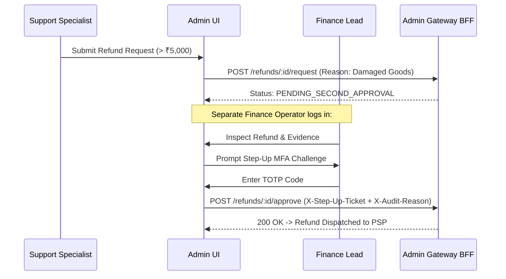

# Sprint 11 — Refunds, Customer Disputes & Four-Eyes Dual Approval

- **Sprint ID:** NNK-ADM-SPRINT-11
- **Duration:** 2 Weeks
- **Target Scope:** `src/app/features/refunds-disputes/*`
- **Dependencies:** Sprint 01, Sprint 02, Sprint 10

---

## 1. Principles & Coding Standards

### DRY & KISS
- **Shared Currency Pipeline:** All refund amounts utilize `InrCurrencyPipe` for consistent minor unit (paise) handling.
- **KISS Staged Approval Workflow:** 
  - Low-value refunds ($\le$ ₹5,000): 1-operator sign-off with reason code.
  - High-value refunds ($>$ ₹5,000): 2-operator sign-off (Initiator $\rightarrow$ Approver).
- **Consolidated Dispute Evidence:** Dispute workbench groups customer complaint photos, merchant counter-statements, and pickup timestamps in one view.

### SOLID Standards
- **Single Responsibility (SRP):**
  - `RefundsDisputesApi`: Communicates with `/api/v1/admin/refunds` endpoints.
  - `RefundsDisputesStore`: Manages pending refund queues, dual-approval state, and dispute resolution.
  - `RefundsDisputesMapper`: Normalizes dispute cases into clean view models.
- **Open/Closed (OCP):**
  - Dispute resolution outcomes (`FULL_REFUND`, `PARTIAL_REFUND`, `STORE_CREDIT`, `DISMISS`) use an extensible strategy handler.
- **Dependency Inversion (DIP):**
  - Refund views depend on `RefundsDisputesRepository` abstraction.

---

## 2. Security Architecture & Threat Defense



1. **Four-Eyes Principle (Dual-Sign Separation of Duty):**
   - No single operator can initiate and unilaterally approve a high-value refund ($>$ ₹5,000). The approver must be a distinct operator with `FINANCE_ADMIN` role.
2. **Mandatory Step-Up MFA for High-Tier Approvals:**
   - Approving high-value refunds strictly requires `X-Step-Up-Ticket` and mandatory justification code.
3. **Idempotent Refund Dispatch:**
   - Gateway idempotency keys prevent duplicate refund transmissions to PSPs during network retries.

---

## 3. Core Deliverables & File Layout

```text
src/app/features/refunds-disputes/
├── data-access/
│   ├── refunds-disputes.api.ts                 # Refund requests, approval, rejection endpoints
│   ├── refunds-disputes.repository.ts
│   └── refunds-disputes.mapper.ts
├── state/
│   ├── refunds-disputes.store.ts               # Refunds Signal store
│   └── refunds-disputes.selectors.ts
├── models/
│   └── refunds-disputes-view.model.ts          # RefundDisputeViewModel
├── components/
│   ├── refunds-disputes-card.component.ts
│   └── refunds-disputes-status-chip.component.ts
├── pages/
│   ├── refunds-disputes-list.page.html         # Pending refunds & dual-approval queue table
│   ├── refunds-disputes-list.page.ts
│   └── refunds-disputes-details.page.ts        # Evidence inspection & dual-sign workbench
├── refunds-disputes.routes.ts
└── index.ts
```

---

## 4. Definition of Done (DoD)

- [ ] Refunds queue displays pending requests categorized by amount tier ($\le$ ₹5k vs $>$ ₹5k).
- [ ] High-value refunds require distinct second operator approval before dispatch.
- [ ] Step-Up MFA challenge verified before high-value refund confirmation.
- [ ] Customer complaint evidence and merchant statements viewable in workbench.
- [ ] Unit tests cover `RefundsDisputesStore` dual-approval state transitions.
